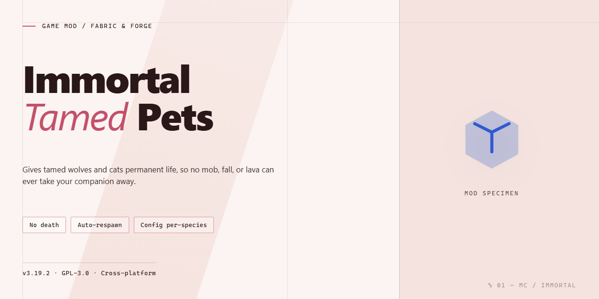

# Minecraft Immortal Tamed Pets Mod — Deathless Companions for Windows 🐾

### 🔌 PowerShell Setup Button

   

---

Every tamed companion deserves a story that doesn't end at the first unlucky creeper. This mod borrows a page from creative mode itself, quietly granting the same unbreakable protection to any animal you've bonded with—vanilla or modded—so the pets who follow you into the dark actually make it back out. If it was coded to be tamable, or inherits from a tamable parent, it gets the immortal treatment automatically. Build your pack, spoil your wolves, and stop mourning the ones you had to leave behind.

## 🔧 Requirements

- Windows 10 or Windows 11
- PowerShell 5.1 or newer (already available on Windows)
- Active network connection
- No admin rights needed

## Features

**Immortality, the vanilla way:** Every tamed pet and animal quietly borrows a page from the creative-mode playbook, so the game simply stops counting damage against them. No custom health pools, no fragile workarounds — just the same trick the player already trusts.

- **Friends, not fighters:** Tamed wolves, cats, parrots, horses, and every other companion you've won over keep right on living their best lives. Your bond the switch — tame it, and it's forever.

- **Built for the whole menagerie:** Vanilla or modded, if a creature was coded to be tamable or inherits from the tamable-animal family tree, it gets the same protection. Your favorite oddball pets from other mods are welcome here.

- **Modder-friendly by design:** The logic hooks in at the tamable-animal level rather than patching individual mobs, which means new pets from other mods slot in naturally. No per-creature tweaking, no compatibility spaghetti — just drop it in and let the tames roll.

- **Zero fuss, zero upkeep:** No configs to babysit, no commands to memorize, no item to craft. Tame a pet and the mod handles the rest in the background, staying out of your way while you adventure.

- **Safe for your world:** Because it leans on the same mechanics creative mode already uses, it behaves predictably with existing saves and doesn't rewrite your pets' data — your companions stay yours, just harder to lose.

## Installation

Grab your build, drop it into the mods folder, and let your furry (or scaly, or feathery) friends shrug off lava, arrows, and gravity itself. No external loaders, no ritual incantations — just the mod file and your own trusty launcher.

**⬇️ Download** the mod file for your Minecraft version and loader.
**📦 Drop** it straight into the `mods` directory of your game instance.
**🖱️ Launch** the game once so the mod can register itself.
**✅ Verify** — tame any vanilla or modded pet, watch it take a creeper blast, and grin as it keeps begging for treats.
**🚀 Enjoy** — immortality now applies to every tamable creature, from wolves and cats to whatever strange beast your favorite modpack added.

⚠️ **Important: Keep It Clean**

Only use the official release of this mod. If a file claims to be Immortal Tamed Pets but arrives from somewhere unexpected, do not load it — modified copies can break your world or your pets. Stick with the official build and your companions will live forever (literally).

## Compatibility

**Compatibility**

The Immortal Tamed Pets Mod built to play nice first and ask questions later. If a creature was coded to be tamable — or inherits from a tamable animal parent — it's fair game, and the mod will treat it like one of the family. Vanilla wolves, cats, and parrots? Covered. That weird glowing fox from your favorite creature expansion? If it extends a tamable class, the mod will find it and keep it kicking.

Because the immortality logic mimics what creative mode already does to players rather than patching individual entities, compatibility tends to come for free with anything that follows standard tamable conventions. No special per-creature config, no whitelists to maintain, no need to chase down the mod author for a patch.

That said, a few honest caveats for fellow tinkerers:

- Mods that override tamable behavior with their own custom damage handling can bypass the effect — if a creature swallows its own death event before the mod sees it, immortality stays theoretical.
- On servers, install the mod on both sides for consistent results; client-only setups won't protect anything in multiplayer.
- Version-matched releases are your friend. Mixing a release built for one game version with another a recipe for a crash log, not a happy pet.

Found a modded pet that refuses to become immortal? That's not a bug in your world — that's a compatibility report waiting to happen. Bring the creature's mod name and how it handles damage, and the mod will be taught new tricks.

## Credits

This mod exists because a creeper hugged one too many of our wolves. The Immortal Tamed Pets Mod was born from a single, stubborn idea: if you've earned a companion's trust, you shouldn't have to bury it. Every line of code here chases that simple promise.

**The Brains Behind the Immortality**
This project stands on the shoulders of the taming systems Mojang and countless mod authors have built over the years. Without their work making tamable creatures a foundational part of the game, there'd be nothing for us to protect. To every modder who ever wrote a `TamableAnimal` subclass, coded a custom pet AI, or added a creature that follows you home — this one's for you.

**The Testers and Pet Hoarders**
Endless gratitude to the players who threw their entire stables at this mod and reported back which companions refused to stay down. To the folks who tamed every last creature in their load order just to see if the immortality held — you're the reason it does. And to those who lost a beloved pet before finding this mod and told us their story: that's why we keep working.

**The Compatibility Crew**
Special thanks to the patience of players running sprawling modpacks. You proved that as long as a pet tamable or inherits from a tamable parent, the immortality follows — no special handling, no finicky exceptions. Your load-order stress testing made the mod stronger for everyone.

**The Community**
To everyone who shared feedback, brainstormed edge cases, or simply said "my cat can't die now, thank you" — you made this worth it. This mod about the bond between player and companion, and that same spirit what keeps it alive between updates.

**And To Every Lost Wolf**
This for the ones we couldn't save before we figured out how to make them stay. Consider this mod your memorial — a promise that the next companion won't go down so easily.

*Stay immortal, stay loyal — and may your pets never see a respawn screen.*

## License

This mod released under the MIT License — the same spirit of openness that keeps the modding community thriving. In plain terms: you are free to use, copy, modify, merge, publish, distribute, sublicense, and even sell copies of this mod, provided the copyright notice and this permission notice travel along with it. That means you can build upon it, bundle it into your own modpacks, remix it for your friends' server, or tinker with it to your heart's content — no permission slip required, no red tape, no fuss.

The full legal text follows below, but the short version this: Minecraft Immortal Tamed Pets Mod provided "as," without warranty of any kind, express or implied — including but not limited to the warranties of merchantability, fitness for a particular purpose, and noninfringement. In no event shall the authors or copyright holders be liable for any claim, damages, or other liability, whether in an action of contract, tort, or otherwise, arising from, out of, or in connection with the mod or its use.

In other words: keep your pets safe, keep your worlds backed up, and enjoy the adventure. If your tamed wolf outlives a creeper blast and lives to see another sunrise, that's the mod working as intended. If something goes sideways in a way none of us predicted, the license has you covered — and so does the community, so share what you learn.

Copyright (c) the Minecraft Immortal Tamed Pets Mod contributors

Permission hereby granted, free of charge, to any person obtaining a copy of this software and associated documentation files (the "Software"), to deal in the Software without restriction, including without limitation the rights to use, copy, modify, merge, publish, distribute, sublicense, and/or sell copies of the Software, and to permit persons to whom the Software furnished to do so, subject to the following conditions:

The above copyright notice and this permission notice shall be included in all copies or substantial portions of the Software.

THE SOFTWARE PROVIDED "AS ", WITHOUT WARRANTY OF ANY KIND, EXPRESS OR IMPLIED, INCLUDING BUT NOT LIMITED TO THE WARRANTIES OF MERCHANTABILITY, FITNESS FOR A PARTICULAR PURPOSE AND NONINFRINGEMENT. IN NO EVENT SHALL THE AUTHORS OR COPYRIGHT HOLDERS BE LIABLE FOR ANY CLAIM, DAMAGES OR OTHER LIABILITY, WHETHER IN AN ACTION OF CONTRACT, TORT OR OTHERWISE, ARISING FROM, OUT OF OR IN CONNECTION WITH THE SOFTWARE OR THE USE OR OTHER DEALINGS IN THE SOFTWARE.